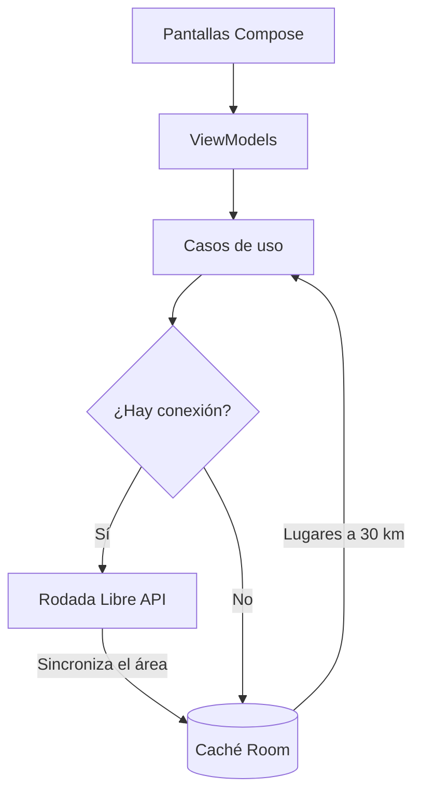

# 🚴‍♂️ Rodada Libre App


> 🇺🇸 **English**: Read this document in English [here](./README.md).

App nativa de Android para [**Rodada Libre**](https://rodadalibre.github.io/), próximamente disponible en Google Play Store. Muestra a los ciclistas urbanos un mapa con los puntos de interés cercanos (estaciones, tiendas, talleres y baños), funciona sin conexión gracias a una caché local y consume la [Rodada Libre API](https://github.com/rodrigocarreonc/RodadaLibreAPI).

## 📋 Tabla de Contenidos
- [Arquitectura y Flujo](#-arquitectura-y-flujo)
- [Stack Tecnológico](#-stack-tecnológico)
- [Instalación Local](#-instalación-local)
- [Estructura del Proyecto](#-estructura-del-proyecto)

## 🏗 Arquitectura y Flujo

La app sigue **Clean Architecture + MVVM**: las pantallas de Compose observan a los ViewModels, los ViewModels llaman a los casos de uso y los casos de uso deciden, a través de los repositorios, si usar la API o la caché local de Room.



### Características Clave

**Offline First:** Los lugares alrededor del usuario se sincronizan en Room y siempre se leen desde la caché, así el mapa sigue funcionando sin conexión. Un error del servidor nunca borra los datos locales.

**Sincronización por Área:** Solo se muestran los lugares a **30 km** del usuario; los de otras ciudades se quedan en caché, pero ocultos.

**Exploración con la Cámara:** Al mover el mapa a otra ciudad se consultan los lugares alrededor de la cámara sin guardarlos, y se omite la consulta dentro del área del propio usuario.

**Sesión Segura:** JWT guardado en DataStore y enviado por un interceptor de OkHttp, con renovación del token y verificación de sesión al iniciar.

**Filtros por Categoría:** Estaciones, tiendas, talleres y baños, además de una pantalla de búsqueda de estaciones cercanas ordenadas por distancia.

## 🛠 Stack Tecnológico
- **Lenguaje y UI: Kotlin 2.3 / Jetpack Compose (Material 3)**

- **Inyección de dependencias: Dagger Hilt**

- **Red: Retrofit + Gson**

- **Almacenamiento local: Room (lugares) / DataStore (tokens)**

- **Mapas y ubicación: Google Maps Compose / Play Services Location**

- **Otros: Navigation Compose, Coil, Splash Screen API, Corrutinas**

## 💻 Instalación Local
Requisitos: Android Studio (AGP 9), JDK 11+, una API key de Google Maps y una instancia en ejecución de la [Rodada Libre API](https://github.com/rodrigocarreonc/RodadaLibreAPI).

**1.- Clonar**
```bash
git clone https://github.com/rodadalibre/RodadaLibreApp.git
cd RodadaLibreApp
```

**2.- Configurar secretos**

Agrega las siguientes claves en *local.properties* (nunca subas este archivo al repositorio). El Secrets Gradle Plugin las inyecta al compilar:
```properties
MAPS_API_KEY=tu_api_key_de_google_maps
API_BASE_URL=http://10.0.2.2:8000/api/
```
`API_BASE_URL` debe terminar en `/`. `10.0.2.2` apunta al `localhost` de tu computadora desde el emulador de Android; las compilaciones debug permiten HTTP sin cifrar para poder llegar a un `php artisan serve` local.

**3.- Compilar y ejecutar**
```bash
./gradlew installDebug
```
O abre el proyecto en Android Studio y ejecuta la configuración `app`.

## 📁 Estructura del Proyecto
```text
com.rodrigocarreon.rodadalibre
├── core/      # Interceptor, ubicación, verificador de red, Retrofit
├── data/      # Repositorios, Room (database/), DataStore (local/), modelos y clientes de la API
├── di/        # Módulos de Hilt (Network, Room)
├── domain/    # Casos de uso y modelos de dominio
└── ui/        # Pantallas Compose, componentes, navegación y ViewModels
```

## 📄 Licencia
Software propietario de José Rodrigo Carreón Cardona. Todos los derechos reservados.
